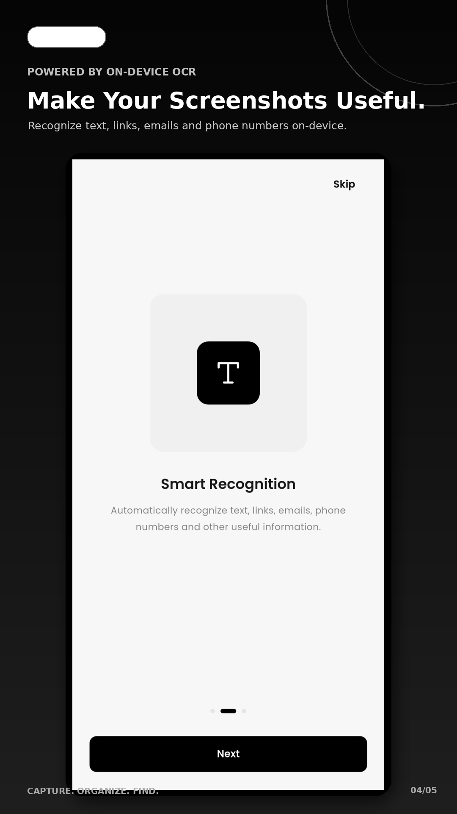
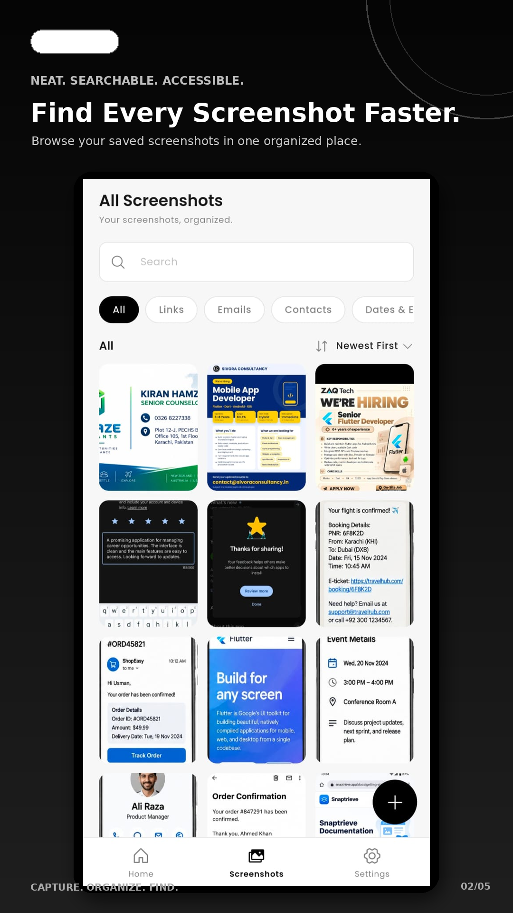
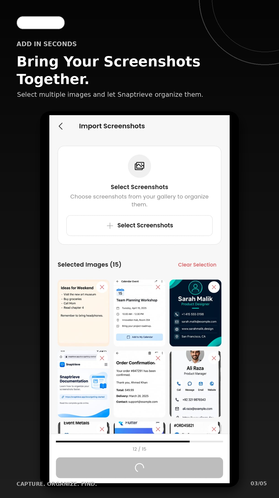
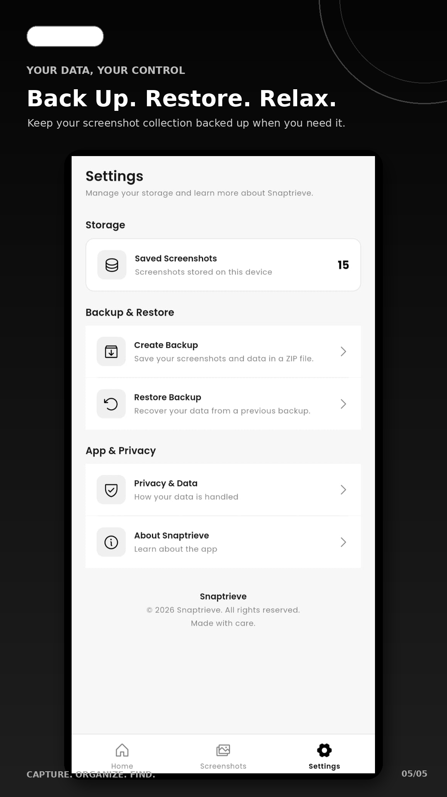

# Snaptrieve

### Capture. Organize. Find.

**Snaptrieve** is an offline-first screenshot management application designed to make saving, organizing, and finding information from screenshots easier.

It uses on-device Optical Character Recognition (OCR) and rule-based categorization to turn ordinary screenshots into searchable, organized content.

<p align="center">
  
</p>

<p align="center">
  <strong>Capture. Organize. Find.</strong>
</p>

---

## 📱 App Screenshots

<p align="center">
  
  
  
</p>

<p align="center">
  
  
</p>

---

## ✨ Key Features

- **Screenshot Import** – Import multiple screenshots from your device.
- **On-Device OCR** – Extract text from screenshots using Google ML Kit.
- **Smart Categorization** – Automatically organize screenshots using rule-based detection.
- **Powerful Search** – Find screenshots through their extracted text.
- **Category Management** – Browse and organize screenshots by category.
- **Screenshot Details** – View screenshots and their extracted information.
- **Backup & Restore** – Export and restore screenshot data using ZIP backup files.
- **Local Data Storage** – Manage screenshot data locally using SQLite.
- **Privacy-Focused** – No login or signup required.

## 🛠️ Technology Stack

| Technology | Purpose |
|---|---|
| Dart | Programming Language |
| Flutter | Application Framework |
| GetX | State Management & Navigation |
| SQLite (sqflite) | Local Database |
| Google ML Kit | Text Recognition |
| Shared Preferences | Local Preferences |
| File Picker | File Selection |
| Archive | Backup & Restore |
| Poppins | Typography |

## 🏗️ Architecture

Snaptrieve uses a feature-first architecture, applying Clean Architecture and Repository Pattern principles to organize application code.

```text
lib/
├── app/
│   ├── bindings/
│   └── routes/
├── core/
│   ├── constants/
│   ├── services/
│   ├── theme/
│   ├── utils/
│   └── widgets/
├── data/
│   ├── database/
│   ├── datasources/
│   ├── models/
│   └── repositories/
├── features/
│   ├── categories/
│   ├── dashboard/
│   ├── import_screenshots/
│   ├── onboarding/
│   ├── screenshots/
│   ├── settings/
│   └── splash/
└── navigation/
```

### Architecture Highlights

- Feature-based module organization.
- GetX controllers for application state management.
- Bindings for dependency registration.
- Repository Pattern for data access.
- Centralized theme, constants, and reusable widgets.
- Local SQLite database for persistent storage.

## 🚀 Getting Started

### Prerequisites

- Flutter SDK
- Dart SDK
- Android Studio or Visual Studio Code
- Android SDK

### Installation

**1. Clone the repository**

```bash
git clone https://github.com/Usman4014/snaptrieve.git
```

**2. Navigate to the project directory**

```bash
cd snaptrieve
```

**3. Install dependencies**

```bash
flutter pub get
```

**4. Run the application**

```bash
flutter run
```

## 🔐 Privacy

Snaptrieve follows an offline-first approach and stores screenshot data locally on the device. No account registration or login is required.

Read the complete [Privacy Policy](https://usman4014.github.io/snaptrieve-privacy-policy/).

## 📦 Application Information

| Property | Details |
|---|---|
| Application | Snaptrieve |
| Package Name | com.usmanshabbir.snaptrieve |
| Platform | Android |
| State Management | GetX |
| Database | SQLite |
| OCR Engine | Google ML Kit |
| Architecture | Feature-First Clean Architecture |

## 👨‍💻 Developer

**Usman Shabbir**

Flutter Developer

- GitHub: [Usman4014](https://github.com/Usman4014)
- Project Repository: [Snaptrieve](https://github.com/Usman4014/snaptrieve)
- Support: support.usmantechlabs@gmail.com

---

<p align="center">
  <strong>Snaptrieve — Capture. Organize. Find.</strong>
</p>