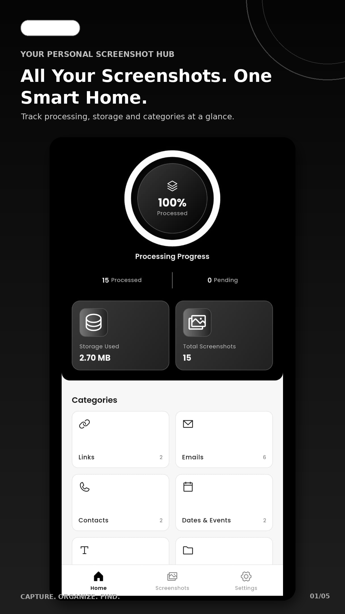

# Snaptrieve

**Capture. Organize. Find.**

Snaptrieve is an offline-first screenshot management application designed to help users organize, search, and retrieve important information from their screenshots effortlessly.

With on-device Optical Character Recognition (OCR) and intelligent rule-based categorization, Snaptrieve transforms ordinary screenshots into searchable and organized content.

## 📱 Screenshots

<p align="center">
  
  
  
</p>

<p align="center">
  
  
</p>

## ✨ Features

- **Screenshot Import** – Import multiple screenshots from your device.
- **On-Device OCR** – Extract text from screenshots using Google ML Kit.
- **Smart Categorization** – Automatically organize screenshots using rule-based detection.
- **Screenshot Search** – Find screenshots using extracted text.
- **Category Management** – Browse and organize screenshots by category.
- **Screenshot Details** – View extracted information and screenshot details.
- **Backup & Restore** – Export and restore your screenshot data through ZIP backups.
- **Offline-First Experience** – Store and manage your data locally.
- **Privacy-Focused** – No login or signup required.

## 🛠️ Technology Stack

| Technology | Purpose |
|---|---|
| Flutter | Application development |
| Dart | Programming language |
| GetX | State management and navigation |
| SQLite (sqflite) | Local database |
| Google ML Kit | On-device text recognition |
| Shared Preferences | Local preferences |
| File Picker | Backup and restore |
| Archive | ZIP backup processing |
| Poppins | Application typography |

## 🏗️ Architecture

Snaptrieve follows a feature-first architecture with Clean Architecture and Repository Pattern principles.

```text
lib/
├── app/
│   ├── bindings/
│   └── routes/
├── core/
│   ├── constants/
│   ├── services/
│   ├── theme/
│   ├── utils/
│   └── widgets/
├── data/
│   ├── database/
│   ├── datasources/
│   ├── models/
│   └── repositories/
├── features/
│   ├── categories/
│   ├── dashboard/
│   ├── import_screenshots/
│   ├── onboarding/
│   ├── screenshots/
│   ├── settings/
│   └── splash/
└── navigation/
```

## 🚀 Getting Started

### Prerequisites

- Flutter SDK
- Dart SDK
- Android Studio or Visual Studio Code
- Android SDK

### Installation

1. Clone the repository:

```bash
git clone https://github.com/Usman4014/snaptrieve.git
```

2. Navigate to the project directory:

```bash
cd snaptrieve
```

3. Install dependencies:

```bash
flutter pub get
```

4. Run the application:

```bash
flutter run
```

## 🔐 Privacy

Snaptrieve is designed with an offline-first approach. Screenshot data is managed locally on the device, and the application does not require user authentication.

Read the full [Privacy Policy](https://usman4014.github.io/snaptrieve-privacy-policy/).

## 📦 Application Details

| Property | Details |
|---|---|
| Application Name | Snaptrieve |
| Package Name | com.usmanshabbir.snaptrieve |
| Platform | Android |
| Architecture | Feature-First Clean Architecture |
| State Management | GetX |
| Database | SQLite |
| OCR | Google ML Kit |

## 👨‍💻 Developer

**Usman Shabbir**

Flutter Developer | Mobile Application Development

- GitHub: [@Usman4014](https://github.com/Usman4014)
- Email: support.usmantechlabs@gmail.com

---

**Snaptrieve — Capture. Organize. Find.**